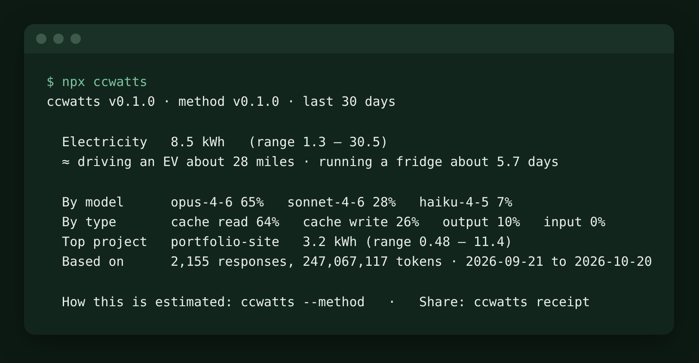
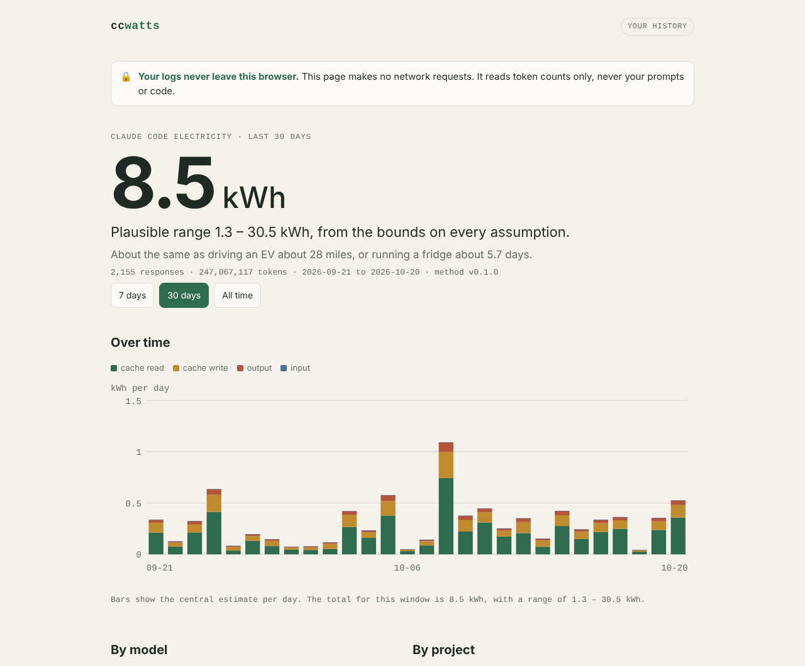

# ccwatts

**See how much electricity your AI coding uses.** ccwatts reads the logs Claude Code already keeps on your machine and turns token counts into an electricity estimate. The estimate is always a range, and every assumption is sourced.



> Screenshots use synthetic sample data (`fixtures/claude-code/demo.jsonl`), not anyone's real usage.

## Why it exists

Developers run AI agents all day, and almost nobody can see what that costs in electricity. Providers don't publish energy per token, and public estimates disagree by about 10x. In 2026 the climate scientist Zeke Hausfather worked out his own Claude Code use by hand: about 170 kWh over eight weeks. ccwatts packages that kind of analysis into one command, with the assumptions out in the open.

| Problem | What ccwatts does |
|---|---|
| You can't see your AI electricity use | One command reads your local Claude Code logs and gives you a kWh range |
| Public numbers disagree by 10x | Always a range, never a single number. Every parameter has a source, date and confidence label ([METHODOLOGY.md](METHODOLOGY.md)) |
| Logs contain private code and prompts | Nothing leaves your machine. No servers, no accounts, no telemetry. It reads counts only |
| Claude Code deletes old logs | ccwatts keeps its own daily counts, so your history survives |
| Most people won't install a CLI | A one-file web page with sample data and a share card |

## What you get

- **`ccwatts`**: electricity for the last 30 days, with an everyday comparison and the split by model, token type and project. Add `--by model|day|project|type`, `--since 7d`, `--json`, or `--method` for every parameter and its source.
- **`ccwatts history`**: a weekly trend that outlives Claude Code's log cleanup, plus `--export csv`.
- **`ccwatts receipt`**: a share line, a ready-to-paste LinkedIn post, and a 1200×627 card.
- **`ccwatts dashboard`**: an offline HTML dashboard of your history, with "Save PNG for LinkedIn".

| Dashboard | Share card | Playground on a phone |
|---|---|---|
|  |  |  |

## How the estimate works

```
energy = Σ tokens × energy per token[model family, token type]
```

Output tokens cost the most. Fresh input costs less, and **cache reads** (the agent re-reading context it has already seen) cost less still per token. Cache reads are usually 90%+ of an agent's tokens, though, so they often end up driving the total. Each parameter has a low and high bound, and they combine on a log scale into the range you see. Sanity checks against Google's measured 0.24 Wh median prompt, Microsoft's 0.34 Wh median query and Hausfather's 170 kWh run as unit tests. The full write-up is in [METHODOLOGY.md](METHODOLOGY.md), and the numbers are in [methodology/params.json](methodology/params.json).

## Privacy

- **The CLI** reads `~/.claude/projects/**/*.jsonl` and keeps only token counts, model, day and project. Projects are stored as a hash plus the folder name, never the full path. It makes no network calls.
- **The web page** has a Content-Security-Policy of `default-src 'none'` with a hash-pinned script, so the browser itself blocks any request. Tests check this, and `npm run check:browser` confirms zero requests in a real browser.
- **History** lives in `~/.ccwatts/history.jsonl` (counts only). Delete it any time.

## Try it

Not on npm yet, because the name isn't final. From a clone:

```
npm install
npm run build
node packages/cli/dist/index.js            # your last 30 days
node packages/cli/dist/index.js dashboard  # offline dashboard
node packages/cli/dist/index.js --path fixtures/claude-code/demo.jsonl   # sample data
```

Node 20+. No runtime dependencies.

## How it's built

TypeScript monorepo: `packages/core` holds the pure parsing, energy model and receipt code, shared by `packages/cli` (terminal) and `packages/web` (one static HTML page). Log parsing sits behind a small adapter interface, so other agent CLIs can be added later without touching the energy model. The product reasoning is written down: [VISION.md](VISION.md) (problems and answers), [ANCHORS.md](ANCHORS.md) (decisions and what was cut), [PLAN.md](PLAN.md) (build plan) and [IDEAS.md](IDEAS.md) (ideas and lessons).

## Status

v0.1, pre-release. Next steps: run it on real logs from a few developers (friend beta), get an outside check of the cache-read factor, and publish to npm.

## License

Code: MIT ([LICENSE](LICENSE)). Methodology and parameters (`METHODOLOGY.md`, `methodology/params.json`): [CC BY 4.0](https://creativecommons.org/licenses/by/4.0/), so reuse them freely, with credit.

Built by [Chase Holroyd](https://chaseholroyd.com), with Claude Code.

ccwatts is an independent project and is not affiliated with or endorsed by Anthropic. Claude and Claude Code are trademarks of Anthropic, PBC.
