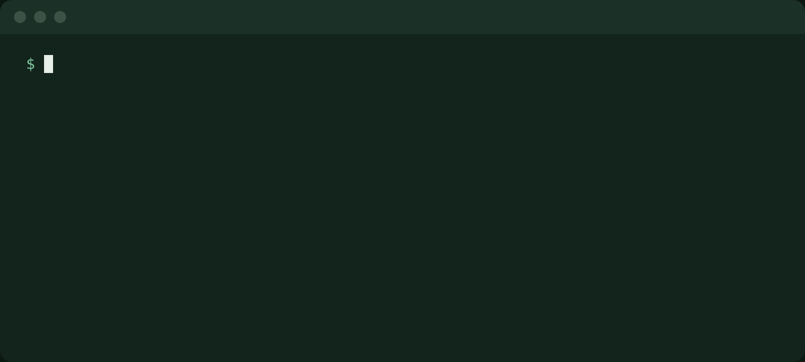
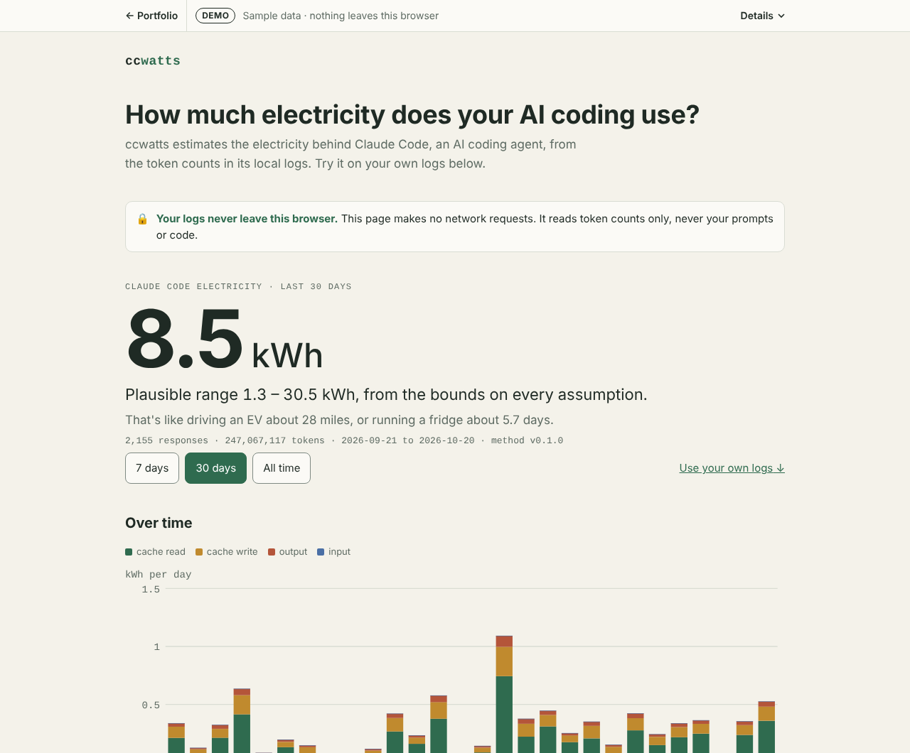
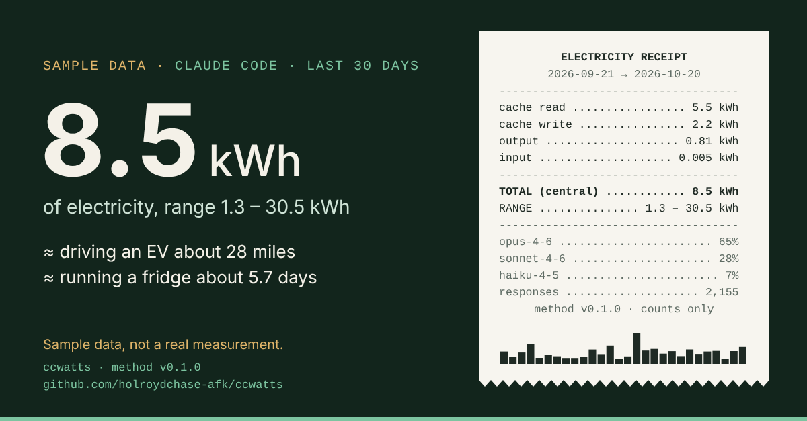
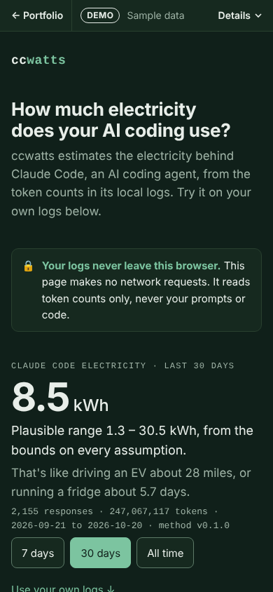
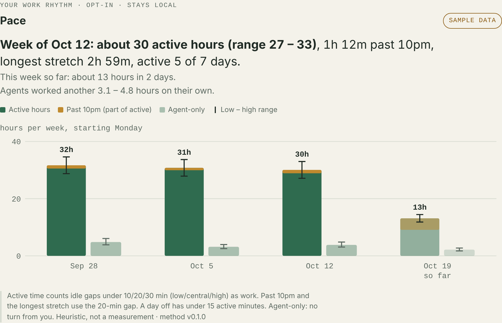
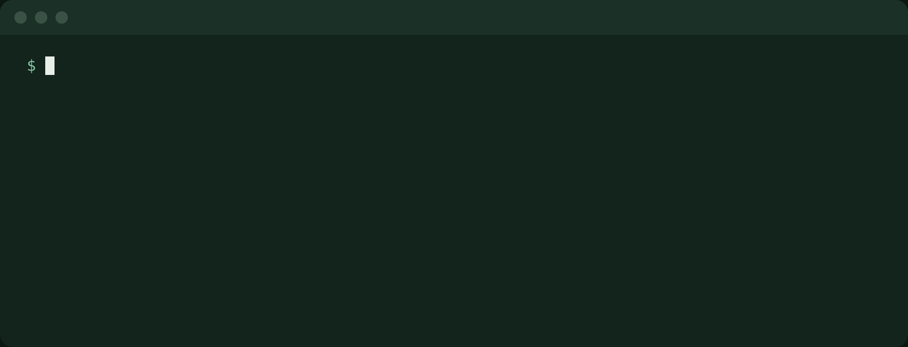

# ccwatts

[](https://github.com/holroydchase-afk/ccwatts/actions/workflows/ci.yml)

**See how much electricity your AI coding uses.** ccwatts reads the logs Claude Code already keeps on your machine and turns token counts into an electricity estimate. The estimate is always a range, and every assumption is sourced.

**[Try it in your browser](https://chaseholroyd.com/ccwatts/)**: it opens on sample data, needs no install or sign-in, and your own logs never leave the page.



> Screenshots and the terminal recording use synthetic sample data (`fixtures/claude-code/demo.jsonl`), not anyone's real usage. The output is the real CLI's.

## Why it exists

Developers run AI agents all day, and almost nobody can see what that costs in electricity. Providers don't publish energy per token, and public estimates disagree by about 10x. In 2026 the climate scientist Zeke Hausfather worked out his own Claude Code use by hand: about 170 kWh over eight weeks. ccwatts packages that kind of analysis into one command, with the assumptions out in the open.

| Problem | What ccwatts does |
|---|---|
| You can't see your AI electricity use | One command reads your local Claude Code logs and gives you a kWh range |
| Public numbers disagree by 10x | Always a range, never a single number. Every parameter has a source, date and confidence label ([METHODOLOGY.md](METHODOLOGY.md)) |
| Logs contain private code and prompts | Nothing leaves your machine. No servers, no accounts, no telemetry. It reads counts only |
| Claude Code deletes old logs | ccwatts keeps its own daily counts, so your history survives |
| Most people won't install a CLI | A one-file web page with sample data and a share card |

## What you get

- **`ccwatts`**: electricity for the last 30 days, with an everyday comparison and the split by model, token type and project. Add `--by model|day|project|type`, `--since 7d`, `--json`, or `--method` for every parameter and its source.
- **`ccwatts history`**: a weekly trend that outlives Claude Code's log cleanup, plus `--export csv`.
- **`ccwatts receipt`**: a share line, a ready-to-paste LinkedIn post, and a 1200×627 card.
- **`ccwatts dashboard`**: an offline HTML dashboard of your history, with "Save PNG for LinkedIn".

| Playground on a laptop | Share card | Playground on a phone |
|---|---|---|
|  |  |  |

In the playground, a **"What if?" slider** moves the least certain assumption, what a cache read costs (the method uses 10% of fresh input and tests 1% to 25%), and recomputes your number and its range live. It's a what-if only: the share card and LinkedIn post always use the published estimate.

## How the estimate works

```
energy = Σ tokens × energy per token[model family, token type]
```

Output tokens cost the most. Fresh input costs less, and **cache reads** (the agent re-reading context it has already seen) cost less still per token. Cache reads are usually 90%+ of an agent's tokens, though, so they often end up driving the total. Each parameter has a low and high bound, and they combine on a log scale into the range you see. Sanity checks against Google's measured 0.24 Wh median prompt, Microsoft's 0.34 Wh median query and Hausfather's 170 kWh run as unit tests. The full write-up is in [METHODOLOGY.md](METHODOLOGY.md), and the numbers are in [methodology/params.json](methodology/params.json).

## Privacy

- **The CLI** reads `~/.claude/projects/**/*.jsonl` and keeps only token counts, model, day and project. Projects are stored as a hash plus the folder name, never the full path, and the hash stays in the local history file: `--json`, MCP answers and the dashboard file show only the folder name. It makes no network calls.
- **The web page** has a Content-Security-Policy of `default-src 'none'` with a hash-pinned script, so the browser itself blocks any request. Tests check this, and `npm run check:browser` confirms zero requests in a real browser.
- **History** lives in `~/.ccwatts/history.jsonl` (counts only). Delete it any time.

## Pace (opt-in)

`ccwatts pace` shows your work rhythm from the same logs: active hours this week (a range), time past 10pm, longest stretch, days off, and how long agents worked on their own, with a four-week table. It compares you only with your own earlier weeks. It's a heuristic, not a measurement, and it never gives a verdict.



```
npx ccwatts pace --demo   # try it on synthetic sample data
npx ccwatts pace          # your own logs
```

- `~/.ccwatts/pace.jsonl` holds daily minutes and whole hours only: no timestamps, no time zone, no content.
- It's created only when you run `ccwatts pace`. Delete it any time.
- It's never shared. `ccwatts receipt` adds one line with this week's active hours only if you pass `--share-pace`.

## Bedtime nudge (opt-in)

Working late? Turn on the bedtime nudge and, from 11pm to 5am, the status line gets a second line suggesting bed, in a persona you pick: serious (`coach`, `researcher`, `stoic`) or funny (`grandma`, `narrator`, `pirate`, `haiku`, `sergeant`), or `random` for a new one each hour.

```
⚡ ~9.1 Wh this session (range 2.3 – 27.5) · method v0.1.0
🌙 Sweetheart, it's 1:14am. The computer will still be there in the morning.
```

```
🌙 Few creatures stir at 1:14am. Most of them are owls. You are not an owl.
🌙 The bug will wait here/patient as a sleeping cat/so should you, my friend
🌙 Drop and give me eight... hours. Of sleep. That's an order!
```

```
npx ccwatts nudge --preview                      # one line from each persona, changes nothing
npx ccwatts nudge on --persona grandma --after 23
npx ccwatts nudge off
```



The lines rotate, so each persona has more than one way of saying it.

It's off by default. It only shows in the status line (set it up with `/ccwatts:statusline` in the plugin, or see [Status line](#status-line) below; `/ccwatts:nudge` turns the nudge on from the plugin), with no notifications or sounds, and it never blocks work. The setting lives in `~/.ccwatts/nudge.json`.

## Try it

ccwatts is on npm. With Node 20+:

```
npx ccwatts               # your last 30 days
npx ccwatts --by project  # also: model, day, type
npx ccwatts history       # weekly trend, survives log cleanup
npx ccwatts receipt       # share line, LinkedIn post and card
npx ccwatts dashboard     # offline dashboard
npx ccwatts --demo        # no Claude Code logs? try it on sample data
```

No runtime dependencies. To build from source: `npm install && npm run build && node packages/cli/dist/index.js`.

### Inside Claude Code

ccwatts is also a Claude Code plugin, so you can check your number without leaving a session:

```
/plugin marketplace add holroydchase-afk/ccwatts
/plugin install ccwatts@ccwatts
```

Then type `/ccwatts` (it completes to `/ccwatts:ccwatts`). It takes the same options as the CLI, for example `/ccwatts history` or `/ccwatts --by project`. Run `/ccwatts:statusline` once to add a status line that shows the current session's estimate after every response. Installing the plugin also adds the MCP tools below, so you can just ask Claude. The plugin runs the same local CLI, so nothing leaves your machine.

### Status line

The status line shows the current session's estimate after every response, and the [bedtime nudge](#bedtime-nudge-opt-in) when it's on. With the plugin, run `/ccwatts:statusline` once. Without it, install the CLI (`npm install -g ccwatts`) and add this to `~/.claude/settings.json`:

```json
"statusLine": { "type": "command", "command": "ccwatts statusline" }
```

### Ask Claude about it (MCP server)

`ccwatts mcp` is a local [MCP](https://modelcontextprotocol.io) server, so Claude Code can answer "how much energy did my sessions use this week?" itself. It has four read-only tools: `energy_summary`, `energy_by_project`, `energy_weekly` (each takes an optional `since`, like `7d` or `all`) and `methodology`. Every answer is a low/central/high range in Wh with the method version, counts only, and projects by folder name, never the full path.

It runs on stdio: Claude Code starts it when it needs it and talks to it over a pipe. There is no port, no listener and no network. You don't run it by hand: `ccwatts mcp --help` prints the line to add it, and typed in a terminal it says what it is waiting for.

Installing the plugin (above) also adds the MCP tools: the plugin registers the server itself, so there is nothing else to run. `/mcp` lists it as `plugin:ccwatts:ccwatts`, and you can switch it off there.

Without the plugin:

```
claude mcp add ccwatts -- npx -y ccwatts mcp
```

From a clone of this repo (after `npm install && npm run build`):

```
claude mcp add ccwatts -- node /path/to/ccwatts/packages/cli/dist/index.js mcp
```

`-y` matters: without it `npx` can stop to ask before installing, and that prompt would land in the MCP pipe.

## How it's built

TypeScript monorepo: `packages/core` holds the pure parsing, energy model and receipt code, shared by `packages/cli` (terminal) and `packages/web` (one static HTML page). `plugins/ccwatts` wraps the same CLI as a Claude Code plugin, and `ccwatts mcp` serves the same numbers to Claude Code as MCP tools. Log parsing sits behind a small adapter interface, so other agent CLIs can be added later without touching the energy model. The product reasoning is written down: [VISION.md](VISION.md) (problems and answers), [ANCHORS.md](ANCHORS.md) (decisions and what was cut), [PLAN.md](PLAN.md) (build plan) and [IDEAS.md](IDEAS.md) (ideas and lessons).

If you clone it to contribute, `npm install` turns on a pre-commit hook (`.githooks/pre-commit`) that refuses a commit containing a home path, an email address, a token or key, or a `.env` file. `npm test` and CI run the same check (`scripts/check-private.ts`) over the whole repo.

## Status

v0.1.2 on npm (includes the `ccwatts mcp` server), plus a Claude Code plugin from this repo that registers it. Next steps: run it on real logs from a few developers (friend beta) and get an outside check of the cache-read factor.

## License

Code: MIT ([LICENSE](LICENSE)). Methodology and parameters (`METHODOLOGY.md`, `methodology/params.json`): [CC BY 4.0](https://creativecommons.org/licenses/by/4.0/), so reuse them freely, with credit.

Built by [Chase Holroyd](https://chaseholroyd.com), with Claude Code.

ccwatts is an independent project and is not affiliated with or endorsed by Anthropic. Claude and Claude Code are trademarks of Anthropic, PBC.
